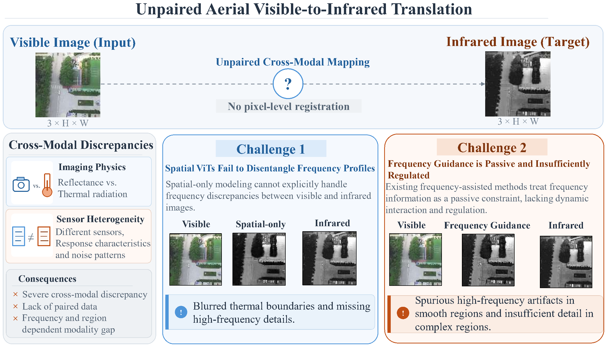
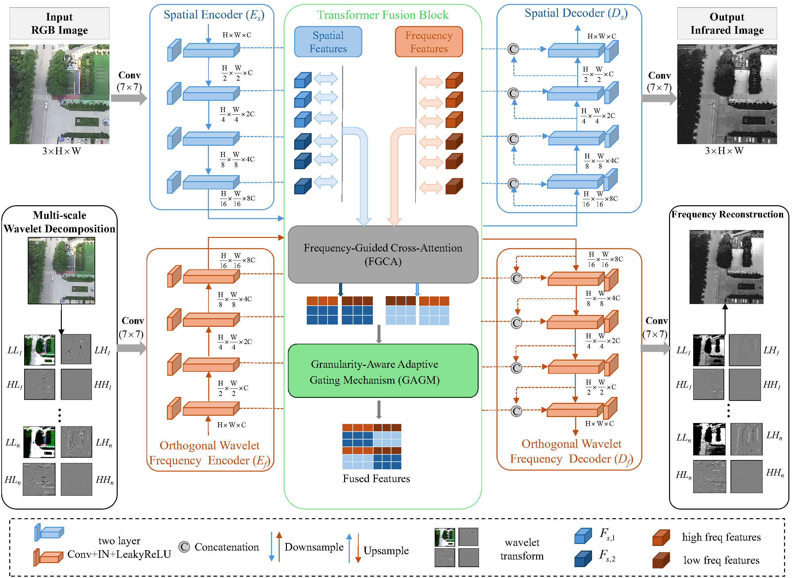
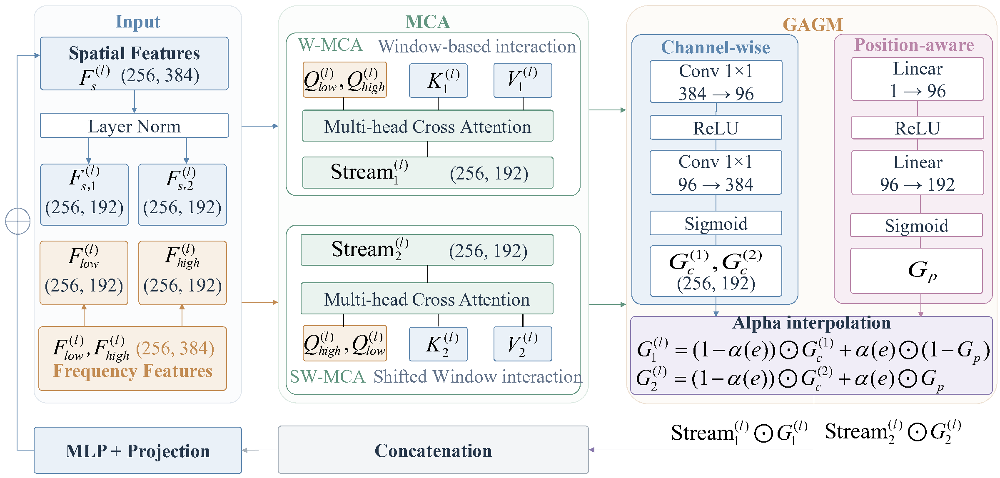
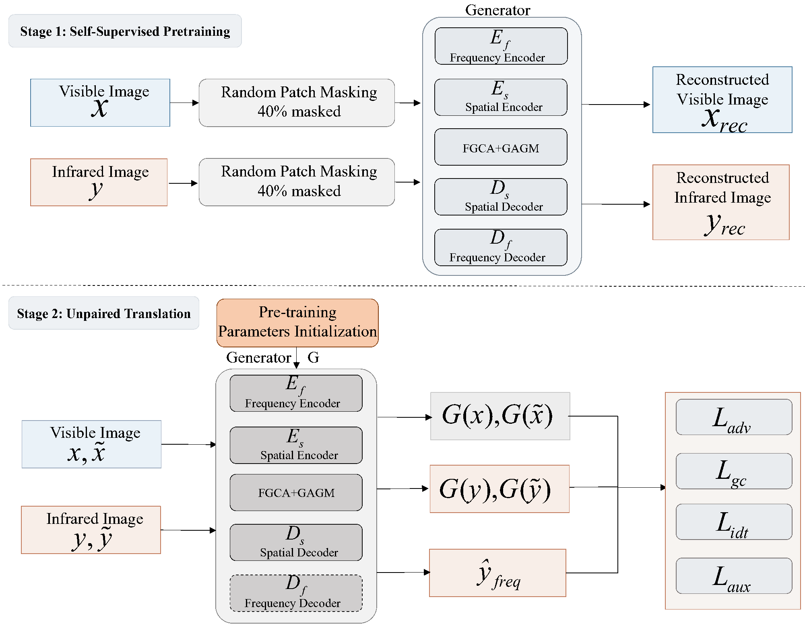
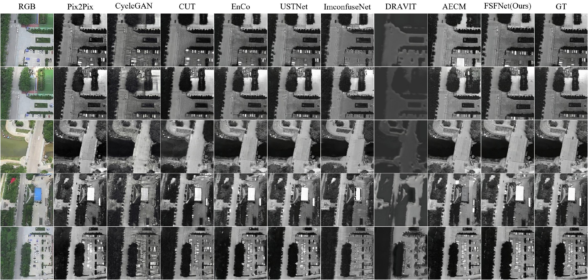
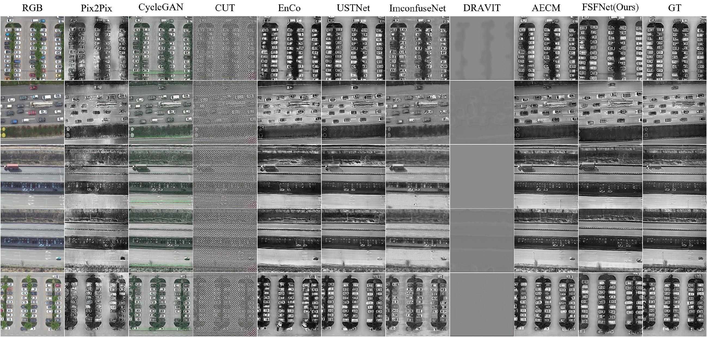
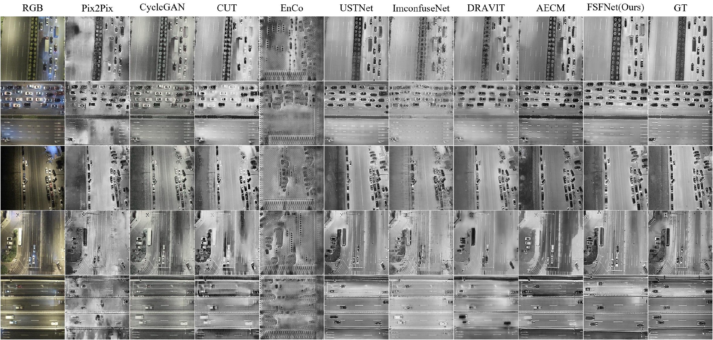

<div align="center">

# Frequency-Guided Spatial-Frequency Collaborative Network for Unregistered Aerial Visible-to-Infrared Image Translation

Submitted to *Engineering Applications of Artificial Intelligence* (EAAI) · Under Review

**Project page: <https://risinginsightmore.github.io/FSFNet/>**

[-red)]()
[]()
[]()
[](#code-release)

</div>

---

## Highlights

- The visible-infrared gap in aerial scenes depends on frequency band and image region.
- Wavelet frequency features act as queries that guide spatial translation.
- Local structural statistics balance local and cross-window attention by region.
- A training-only wavelet decoder keeps infrared spectral structure at no test cost.
- Best perceptual and structural similarity on three public aerial benchmarks.

## Abstract

Thermal infrared imagery enables day-and-night perception from unmanned aerial vehicles, yet large infrared datasets are costly to collect.
Visible-to-infrared translation offers a low-cost alternative, but it must be learned from unregistered data because airborne visible and infrared sensors are rarely aligned.
The gap between the two modalities varies with frequency and with image region.
Low-frequency intensities must be re-mapped from reflectance to thermal radiance, boundaries caused by material or temperature changes persist in both modalities, and many reflection textures have no thermal counterpart.
Spatial-domain translators blur thermal boundaries, while uniform frequency guidance transfers visible textures into homogeneous regions.
As the contribution to artificial intelligence, we propose a frequency-guided spatial-frequency collaborative network (FSFNet) for unpaired translation.
A Haar wavelet encoder separates low- and high-frequency representations, which act as queries in a frequency-guided cross-attention module to retrieve spatial context.
A granularity-aware gating mechanism measures local structural complexity with parameter-free variance statistics and balances local smoothing against cross-window detail at each position.
An auxiliary wavelet decoder used only in training anchors the shared bottleneck to infrared spectral structure without extra inference cost.
As the engineering application, FSFNet generates aerial infrared imagery and, on three public daytime and nighttime drone benchmarks, achieves the best learned perceptual image patch similarity and structural similarity on all three.
On the Aerial Visible-to-Infrared Image Dataset (AVIID-3), it reduces the Fréchet inception distance by 11.5% and improves the peak signal-to-noise ratio by 0.65 dB over a spatial-only baseline.

**Keywords:** Visible-to-infrared image translation · Unpaired image translation · Wavelet transform · Frequency-guided attention · Granular computing · Unmanned aerial vehicle imagery

---

## Motivation

<div align="center">



*Unpaired aerial visible-to-infrared translation and the two failure types that motivate this work. Spatial-only translators blur thermal boundaries and lose high-frequency detail, and frequency guidance without regional regulation introduces spurious textures in smooth regions.*

</div>

A visible camera records reflected sunlight, whereas an infrared camera records radiance emitted according to surface temperature and emissivity.
The modality gap is therefore not uniform across frequency bands or image regions: the low-frequency layout must be re-mapped, structural boundaries should be preserved, and reflection-only textures should be suppressed.
These observations define four requirements for unpaired translation: (i) separating the components that need different treatment, (ii) letting them guide translation rather than serve as side information, (iii) determining where high-frequency detail should be preserved, and (iv) retaining infrared spectral structure without paired targets.

## Contributions

1. We formulate the visible-infrared gap in aerial scenes as frequency- and region-dependent and design a dual-path generator around **frequency-guided cross-attention (FGCA)**, in which low- and high-frequency wavelet representations act as attention queries and swap between regular-window and shifted-window streams across layers. The frequency representations are also re-injected at every decoding scale.
2. We propose the **granularity-aware adaptive gating mechanism (GAGM)**, which adapts spatial-frequency fusion to regional complexity through parameter-free structural statistics and a progressive schedule. It reverses the degradation caused by unregulated frequency guidance in texture-rich daytime scenes and suppresses texture artifacts on homogeneous surfaces.
3. We introduce a **training-only auxiliary wavelet decoder** that anchors the shared bottleneck to infrared spectral structure under unpaired supervision at no inference cost.
4. Experiments on three public aerial benchmarks show that FSFNet ranks first in **11 of the 18** metric evaluations and achieves the best LPIPS and SSIM on all datasets. Ablation studies show that the three components are complementary: the auxiliary decoder lowers the nighttime FID of the dual-path model from 58.47 to 19.23, and GAGM further improves all six metrics on all three datasets.

---

## Method

<div align="center">



*Overall architecture of FSFNet. The spatial encoder E<sub>s</sub> and the Haar wavelet frequency encoder E<sub>f</sub> extract complementary representations in parallel. FGCA uses the low- and high-frequency representations as queries to retrieve spatial context, and GAGM regulates the two attention streams by local structural complexity. The decoder D<sub>s</sub> re-injects the frequency representations at every scale, and the auxiliary wavelet decoder D<sub>f</sub> is used only during training.*

</div>

| Requirement | Component | Role |
|:--|:--|:--|
| (i) Separate the components | Haar wavelet frequency encoder E<sub>f</sub> | Two-level Haar DWT with an independent branch per subband; LL features form F<sub>low</sub>, and LH/HL/HH features form F<sub>high</sub> |
| (ii) Let them guide translation | FGCA | F<sub>low</sub> and F<sub>high</sub> serve as queries over spatial keys and values in regular- and shifted-window streams, and swap streams across layers |
| (iii) Decide where detail is preserved | GAGM | A parameter-free variance-based granularity map weights the two streams at each position, phased in by a progressive schedule |
| (iv) Retain infrared spectral structure | Auxiliary wavelet decoder D<sub>f</sub> | Reconstructs real infrared images from predicted Haar subbands in the identity pass; removed at inference |

<div align="center">



*Structure of FGCA and GAGM. The low- and high-frequency representations serve as queries for cross-attention on regular (W-MCA) and shifted (SW-MCA) windows, and their window assignment alternates across layers. GAGM weights the two attention streams with a channel gate and a granularity-guided position gate.*



*Two-stage training strategy of FSFNet. Stage 1 pretrains the generator by masked image modeling with pixel and wavelet losses. Stage 2 learns the unpaired translation with adversarial, geometric-consistency, identity, and auxiliary losses. The auxiliary wavelet decoder is removed at inference.*

</div>

---

## Results

### Datasets

| Dataset | Illumination | Total Pairs | Train / Test | Resolution (pixels) |
|:--|:-:|:-:|:-:|:-:|
| AVIID-3 | Daytime | 3,216 | 2,412 / 804 | 512 × 512 |
| Day-DroneVehicle | Daytime | 7,660 | 5,745 / 1,915 | 640 × 512 |
| Night-DroneVehicle | Nighttime | 13,140 | 9,855 / 3,285 | 640 × 512 |

During training, visible and infrared images are sampled independently, and the aligned test pairs are used only for evaluation. All images are resized to 256 × 256.

### Comparison with state-of-the-art methods

Over the 18 metric evaluations on the three benchmarks, FSFNet ranks first in 11 and within the top two in 16, and it achieves the best LPIPS and SSIM on all three datasets. All methods are trained from scratch with their public code under the same data splits, input resolution, and evaluation protocol. Best results are in **bold** and second-best are <u>underlined</u>.

#### (a) AVIID-3

| Method | FID↓ | KID↓ | LPIPS↓ | RMSE↓ | SSIM↑ | PSNR↑ |
|:--|:-:|:-:|:-:|:-:|:-:|:-:|
| Pix2Pix | 84.24536 | 0.039870 | 0.284519 | 29.989248 | 0.515265 | 18.956686 |
| CycleGAN | 82.14132 | 0.025350 | 0.300864 | 37.436294 | 0.404162 | 16.847453 |
| CUT | 95.33009 | 0.033596 | 0.350033 | 38.927721 | 0.405757 | 16.492552 |
| EnCo | 84.06712 | 0.028891 | 0.241989 | 26.820914 | 0.499146 | 19.731120 |
| DR-AVIT | 214.85513 | 0.145197 | 0.593349 | 70.787318 | 0.302367 | 11.627863 |
| USTNet | 50.87250 | 0.006881 | <u>0.208130</u> | <u>25.571699</u> | <u>0.574911</u> | <u>20.204583</u> |
| ImconfuseNet | 97.62250 | 0.032440 | 0.283797 | 33.005892 | 0.455096 | 17.926994 |
| CycleMamba | 179.79673 | 0.163505 | 0.649781 | 81.332077 | 0.162434 | 9.975021 |
| AECM | **43.26300** | **0.001933** | 0.246329 | 38.473896 | 0.466449 | 16.835820 |
| **FSFNet (Ours)** | <u>45.00005</u> | <u>0.004547</u> | **0.194302** | **23.714777** | **0.584978** | **20.851626** |

#### (b) Day-DroneVehicle

| Method | FID↓ | KID↓ | LPIPS↓ | RMSE↓ | SSIM↑ | PSNR↑ |
|:--|:-:|:-:|:-:|:-:|:-:|:-:|
| Pix2Pix | 160.00029 | 0.137296 | 0.313117 | 54.334250 | 0.353191 | 13.638398 |
| CycleGAN | 94.05906 | 0.054729 | 0.342277 | 58.77783 | 0.268798 | 12.877211 |
| CUT | 445.85667 | 0.532393 | 0.684109 | 73.757324 | 0.063644 | 10.802577 |
| EnCo | 83.00264 | 0.048721 | 0.299899 | 55.599082 | 0.376335 | 13.553605 |
| DR-AVIT | 443.69373 | 0.452442 | 0.853234 | 57.026964 | 0.343010 | 13.132876 |
| USTNet | 27.91764 | 0.003475 | <u>0.216254</u> | <u>47.719773</u> | <u>0.486843</u> | <u>14.992926</u> |
| ImconfuseNet | 69.78602 | 0.033836 | 0.302829 | 48.990387 | 0.363916 | 14.577407 |
| CycleMamba | 244.53473 | 0.199789 | 0.741614 | 75.562867 | 0.129687 | 10.700540 |
| AECM | **25.06893** | **0.000781** | 0.232957 | 54.929075 | 0.431469 | 13.689555 |
| **FSFNet (Ours)** | <u>25.16958</u> | <u>0.001737</u> | **0.209149** | **47.153408** | **0.500442** | **15.094191** |

#### (c) Night-DroneVehicle

| Method | FID↓ | KID↓ | LPIPS↓ | RMSE↓ | SSIM↑ | PSNR↑ |
|:--|:-:|:-:|:-:|:-:|:-:|:-:|
| Pix2Pix | 83.18299 | 0.072839 | 0.347109 | 50.658449 | 0.358204 | 14.140496 |
| CycleGAN | 50.52592 | 0.030129 | 0.391831 | 55.457723 | 0.304812 | 13.385118 |
| CUT | 79.82762 | 0.062109 | 0.402816 | 56.226394 | 0.329726 | 13.237177 |
| EnCo | 137.4847 | 0.122597 | 0.596731 | 63.097004 | 0.153195 | 12.238241 |
| DR-AVIT | 39.86782 | 0.020800 | 0.342772 | 52.329855 | 0.359702 | 13.856874 |
| USTNet | 18.39930 | <u>0.004124</u> | <u>0.301192</u> | <u>48.862267</u> | <u>0.441370</u> | <u>14.495124</u> |
| ImconfuseNet | 68.15952 | 0.048021 | 0.365475 | **46.865640** | 0.335152 | **14.856630** |
| CycleMamba | 311.45272 | 0.342749 | 0.646167 | 63.269658 | 0.206319 | 12.169338 |
| AECM | **17.61687** | 0.004252 | 0.328866 | 57.859153 | 0.346517 | 13.052859 |
| **FSFNet (Ours)** | <u>17.95355</u> | **0.003609** | **0.298798** | 48.991262 | **0.447708** | 14.485825 |

### Ablation study

Config. 0 is the spatial-only counterpart of FSFNet. Config. 1 adds the dual-path generator (wavelet encoder, FGCA, and multiscale frequency injection), Config. 2 further adds the auxiliary wavelet decoder, and Config. 3 is the full FSFNet with GAGM.

#### (a) AVIID-3

| Config. | Dual-path generator | Aux. decoder | GAGM | FID↓ | KID↓ | LPIPS↓ | RMSE↓ | SSIM↑ | PSNR↑ |
|:-:|:-:|:-:|:-:|:-:|:-:|:-:|:-:|:-:|:-:|
| 0 | ✗ | ✗ | ✗ | 50.87250 | 0.006881 | 0.208130 | 25.571699 | 0.574911 | 20.204583 |
| 1 | ✓ | ✗ | ✗ | 46.19873 | 0.005581 | 0.204816 | 25.874743 | 0.573891 | 20.171928 |
| 2 | ✓ | ✓ | ✗ | 45.42301 | 0.005299 | 0.196854 | 24.538258 | 0.582915 | 20.591140 |
| 3 | ✓ | ✓ | ✓ | **45.00005** | **0.004547** | **0.194302** | **23.714777** | **0.584978** | **20.851626** |

#### (b) Day-DroneVehicle

| Config. | Dual-path generator | Aux. decoder | GAGM | FID↓ | KID↓ | LPIPS↓ | RMSE↓ | SSIM↑ | PSNR↑ |
|:-:|:-:|:-:|:-:|:-:|:-:|:-:|:-:|:-:|:-:|
| 0 | ✗ | ✗ | ✗ | 27.91764 | 0.003475 | 0.216254 | 47.719773 | 0.486843 | 14.992926 |
| 1 | ✓ | ✗ | ✗ | 25.74340 | 0.002036 | 0.213349 | 48.694017 | 0.493474 | 14.784883 |
| 2 | ✓ | ✓ | ✗ | 27.14012 | 0.002664 | 0.221713 | 49.416147 | 0.487257 | 14.736482 |
| 3 | ✓ | ✓ | ✓ | **25.16958** | **0.001737** | **0.209149** | **47.153408** | **0.500442** | **15.094191** |

#### (c) Night-DroneVehicle

| Config. | Dual-path generator | Aux. decoder | GAGM | FID↓ | KID↓ | LPIPS↓ | RMSE↓ | SSIM↑ | PSNR↑ |
|:-:|:-:|:-:|:-:|:-:|:-:|:-:|:-:|:-:|:-:|
| 0 | ✗ | ✗ | ✗ | 18.39930 | 0.004124 | 0.301192 | **48.862267** | 0.441370 | **14.495124** |
| 1 | ✓ | ✗ | ✗ | 58.47422 | 0.044026 | 0.363766 | 54.264105 | 0.395591 | 13.556499 |
| 2 | ✓ | ✓ | ✗ | 19.23238 | 0.004763 | 0.302936 | 49.074746 | 0.443146 | 14.470825 |
| 3 | ✓ | ✓ | ✓ | **17.95355** | **0.003609** | **0.298798** | 48.991262 | **0.447708** | 14.485825 |

The dual-path generator lowers FID on AVIID-3 and Day-DroneVehicle. At night, where visible frequency cues are weak, the auxiliary decoder brings the FID of the dual-path model back from 58.47 to 19.23; in texture-rich daytime scenes, GAGM reverses the degradation of unregulated frequency guidance. The full model is the most consistent across all three datasets.

### Computational complexity

Measured on a single NVIDIA GeForce RTX 5090 GPU with a 256 × 256 input and a batch size of 1 (FLOPs counted with thop; time averaged over 200 forward passes after 50 warm-up passes). G, D, and Others list the parameters of the generator, the discriminator, and the remaining modules.

| Method | Params (M) | FLOPs (G) | Time (ms) | G (M) | D (M) | Others (M) |
|:--|:-:|:-:|:-:|:-:|:-:|:-:|
| Pix2Pix | 57.18 | 36.30 | 2.00 | 54.41 | 2.77 | -- |
| CycleGAN | 28.29 | 113.73 | 18.06 | 22.76 | 5.53 | -- |
| CUT | 16.91 | 128.26 | 6.51 | 11.38 | 5.53 | -- |
| EnCo | 14.66 | 128.26 | 10.68 | 11.38 | 2.77 | F: 0.51 |
| DR-AVIT | 56.84 | 162.67 | 24.56 | 31.69 | 25.15 | -- |
| USTNet | 33.69 | 69.49 | 29.57 | 30.92 | 2.77 | -- |
| ImconfuseNet | 0.28 | 32.31 | 12.33 | 0.26 | 0.02 | -- |
| CycleMamba | 64.63 | 44.78 | 27.38 | 61.86 | 2.77 | -- |
| AECM | 27.22 | 128.26 | 9.23 | 11.38 | 1.18 | S-Attn: 14.66 |
| **FSFNet (Ours)** | 35.44 | 84.30 | 36.14 | 32.67 | 2.77 | -- |

FSFNet translates a 256 × 256 image in 36.14 ms (about 27.7 images per second) with a single forward pass, and the auxiliary decoder adds no inference cost because it is removed after training.

---

## Visualization

From left to right: visible input, Pix2Pix, CycleGAN, CUT, EnCo, USTNet, ImconfuseNet, DR-AVIT, AECM, FSFNet, and ground-truth infrared image.

<div align="center">



*Qualitative comparison on AVIID-3.*



*Qualitative comparison on Day-DroneVehicle.*



*Qualitative comparison on Night-DroneVehicle.*

</div>

---

## Code release

The core architecture code has been pre-released in this repository, and the complete code will be released upon acceptance of the paper.

| Released now | Released upon acceptance |
|:--|:--|
| Spatial encoder, Haar wavelet frequency encoder, and multiscale frequency-guided decoder (`ours/models/networks.py`) | Implementation of FGCA (`ours/models/fgca.py`) and GAGM (`ours/models/gagm.py`) |
| Two-stage training pipeline: masked-image-modeling pretraining (`ours/models/FSFNet_pretrain.py`) and unpaired translation training (`ours/models/FSFNet.py`) | Implementation of the auxiliary wavelet decoder D<sub>f</sub> |
| Haar wavelet transform, PatchGAN discriminator, data loading, testing, and evaluation scripts | Loss implementations (`ours/models/losses.py`) and pretrained weights |
| Interfaces of FGCA, GAGM, and D<sub>f</sub> with input and output specifications | |
| Training, testing, and evaluation scripts of all compared methods (`baseline/`) | |

### Repository structure

```
baseline/                    # compared methods with our training, testing, and evaluation scripts
├── Pix2Pix/  CycleGAN/  CUT/  EnCo/  DRAVIT/
└── USTNet/   ImconfuseNet/  CycleMamba/  AECM/
ours/
├── pretrain.py              # Stage 1: self-supervised dual-domain pretraining
├── train.py                 # Stage 2: unpaired translation training
├── test.py                  # inference on the test set
├── split_sample.py          # separate generated and real infrared images for evaluation
├── evaluation_metric.py     # LPIPS, SSIM, PSNR, and RMSE
├── models/
│   ├── networks.py          # generator, frequency encoder, decoder, discriminator
│   ├── wavelet_transform.py # Haar DWT / IWT
│   ├── fgca.py              # FGCA interface
│   ├── gagm.py              # GAGM granularity-map interface
│   ├── FSFNet_pretrain.py   # Stage 1 model and losses
│   └── FSFNet.py            # Stage 2 model and losses
├── data/  options/  util/
└── requirements.txt
```

### Data preparation

Each dataset is organized as unpaired visible (A) and infrared (B) folders:

```
datasets/AVIID-3/
├── trainA/   # visible training images
├── trainB/   # infrared training images
├── testA/    # visible test images
└── testB/    # aligned infrared test images (used only for evaluation)
```

AVIID-3 is available from the [AVIID benchmark](https://doi.org/10.34133/remotesensing.0096), and Day-/Night-DroneVehicle are the daytime and nighttime subsets of [DroneVehicle](https://github.com/VisDrone/DroneVehicle).

### Reproducing the baselines

Each method in `baseline/` is trained from scratch under the same data splits, 256 × 256 input resolution, and evaluation protocol as FSFNet:

```bash
cd baseline/USTNet        # or any other method
bash run_train.sh
bash run_test.sh
```

### Usage

The commands below reproduce the settings in the paper and become fully runnable once the remaining modules are released.

```bash
cd ours
pip install -r requirements.txt

# Stage 1: self-supervised dual-domain pretraining (400 epochs, AdamW, cosine restarts)
python pretrain.py --dataroot ./datasets/AVIID-3 --name FSFNet_Pretrain --gpu_ids 0

# Stage 2: unpaired translation (400 epochs, GAGM schedule T_warmup = 200, T_ramp = 300)
python train.py --dataroot ./datasets/AVIID-3 --name FSFNet --gpu_ids 0 \
    --use_pretrain --pretrain_dir ./checkpoints/FSFNet_Pretrain/FSFNet_Pretrain0

# Testing: test images are resized to 256 x 256 without cropping
python test.py --dataroot ./datasets/AVIID-3 --name FSFNet --name_id 0 --gpu_ids 0

# Evaluation of LPIPS, SSIM, PSNR, and RMSE
python split_sample.py --input ./results/FSFNet/test_latest/images
python evaluation_metric.py --real ./results/FSFNet/test_latest/images_real \
    --fake ./results/FSFNet/test_latest/images_fake --out ./results/FSFNet
```

FID and KID (subset size 500) are computed between the generated and real infrared test images in the Inception-v3 feature space.

---

## Citation

The citation will be provided upon publication.

## Acknowledgements

Parts of the data loading and training utilities are adapted from [pytorch-CycleGAN-and-pix2pix](https://github.com/junyanz/pytorch-CycleGAN-and-pix2pix). The `baseline/` folder contains the official implementations of the compared methods, each with the `run_train.sh`, `run_test.sh`, and evaluation scripts used to obtain the results in the paper; please refer to the original repositories and licenses of these methods.

---

<div align="center">
<sub>This work is under review at <em>Engineering Applications of Artificial Intelligence</em>. The core architecture code has been pre-released, and the complete code will be released upon acceptance.</sub>
</div>
